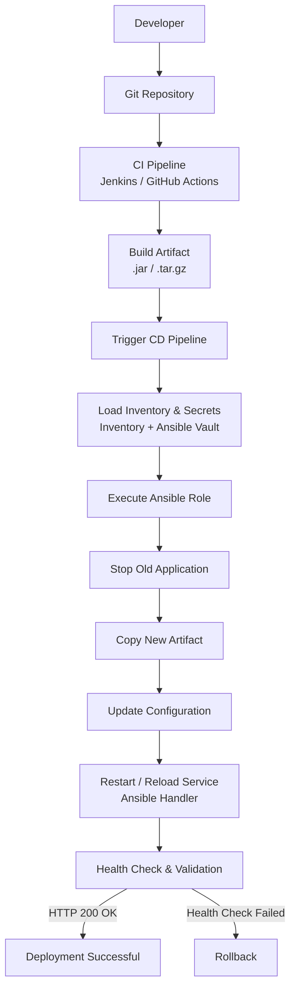

#  Ansible Role CD Workflow

  

---

# Author Table

| **Author** | **Created On** | **Version** | **Last Updated By** | **Last Edited On** | **L0 Reviewer** | **L1 Reviewer** | **L2 Reviewer** |
| :--- | :--- | :--- | :--- | :--- | :--- | :--- | :--- |
| Sarthak Bhatnagar | 28-08-2026 | v1.1 | Sarthak Bhatnagar | 07-09-2026 | Ishaan | Anuj Jain | Piyush Upadhyay |

---

# Table of Contents

1. [Introduction](#1-introduction)
2. [What is Ansible Role](#2-what-is-ansible-role)
3. [Ansible Role Directory Structure](#3-Ansible-Role-Directory-Structure)
4. [Why Ansible Role is Required in CD Workflow](#4-why-ansible-role-is-required-in-cd-workflow)
5. [Ansible Role CD Workflow](#5-ansible-role-cd-workflow)
6. [Advantages and Disadvantages](#6-advantages-and-disadvantages)
7. [Best Practices](#7-best-practices)
8. [Conclusion](#8-conclusion)
9. [Contact Information](#9-contact-information)
10. [References](#10-references)

---

# 1. Introduction

This **documentation** explains the complete Ansible Role CD workflow, starting from building the application artifact and triggering the CD pipeline to executing the Ansible Role, deploying the application, restarting the service, and performing health checks and validation.

It also covers the **Ansible** Role directory structure, tools, advantages and disadvantages, and best practices used for reliable and consistent deployments.

**Ansible Role CD** is used to automate the application deployment process using Ansible Roles within a **Continuous Deployment (CD)** workflow.

---

# 2. What is Ansible Role

An **Ansible Role** is a standard folder format that groups related tasks, variables, files, and handlers together. It breaks large playbooks into small, manageable components.

# 3. Ansible Role Directory Structure

| Directory    | Purpose                                                                        |
| ------------ | ------------------------------------------------------------------------------ |
| `tasks/`     | Contains the main execution steps of the role, usually defined in `main.yml`.  |
| `handlers/`  | Contains actions triggered when changes occur, such as restarting a service.   |
| `templates/` | Contains Jinja2 configuration templates (`.j2`).                               |
| `files/`     | Contains static files and scripts that need to be copied to the target server. |
| `vars/`      | Contains variables used by the role.                                           |
| `defaults/`  | Contains default variables that can be overridden when required.               |
| `meta/`      | Contains role information, metadata, and role dependencies.                    |

---

# 4. Why Ansible Role is Required in CD Workflow

| Requirement                  | Description                                                                              |
| ---------------------------- | ---------------------------------------------------------------------------------------- |
| **Automated Deployment**     | Automates application deployment without manual intervention.                            |
| **Reusable Configuration**   | The same Ansible Role can be reused across multiple servers and environments.            |
| **Consistent Deployment**    | Ensures the same deployment process is followed in every environment.                    |
| **Configuration Management** | Manages application configuration, files, permissions, and services.                     |
| **Reduced Errors**           | Minimizes manual deployment errors and configuration mistakes.                           |
| **CI/CD Integration**        | Easily integrates with Jenkins, GitHub Actions, and other CI/CD tools.                   

---
# 5. Workflow Steps 

---

# 6. Advantages and Disadvantages

### Advantages

| **Advantage**             | **Description**                                                             |
| ------------------------- | --------------------------------------------------------------------------- |
| **Automated Deployment**  | Automates the application deployment process.                               |
| **Reduced Manual Errors** | Minimizes mistakes during application deployment.                           |
| **Reusable Roles**        | Allows the same role to be reused across multiple servers and environments. |
| **Consistent Deployment** | Ensures the same deployment process across different environments.          |
| **CI/CD Integration**     | Easily integrates with Jenkins, GitHub Actions, and other CI/CD tools.      |

### Disadvantages

| **Disadvantage**         | **Description**                                                        |
| ------------------------ | ---------------------------------------------------------------------- |
| **Learning Curve**       | Requires understanding of Ansible Roles and YAML.                      |
| **Complex Roles**        | Roles can become complex in large projects.                            |
| **Debugging Challenges** | Troubleshooting failed deployments can be difficult.                   |
| **Secret Management**    | Sensitive data must be securely managed.                               |
| **Inventory Management** | Maintaining inventory can become challenging in large infrastructures. |
 

---

# 7. Best Practices

| Best Practice                  | Description                                                                                    |
| ------------------------------ | ----------------------------------------------------------------------------------------------      
| **Create Reusable Roles**      | Design roles so they can be reused across multiple applications and environments.              |
| **Maintain Idempotency**       | Ensure that running the same role multiple times does not cause unwanted changes.                      
| **Validate Before Deployment** | Run syntax checks and linting before executing the deployment.                                 |
| **Perform Health Checks**      | Verify that the application is running correctly after deployment.                             |
| **Use CI/CD Integration**      | Integrate Ansible with Jenkins, GitHub Actions, or other CI/CD tools for automated deployment. |
| **Keep Roles Simple**          | Keep tasks, variables, and role responsibilities organized and easy to maintain.               |

---

# 8. Conclusion

This documentation provides a complete overview of the Ansible Role CD workflow and explains how different stages work together to automate application deployment.

By using Ansible Roles with a CD pipeline, deployments can be made automated, consistent, reusable, and less error-prone. This approach is useful for managing application deployments across different environments in a structured way.

---

# 9. Contact Information

| **Name** | **Email** |
| :--- | :--- |
| Sarthak Bhatnagar | [sarthak.bhatnagar.snaatak@mygurukulam.co](mailto:sarthak.bhatnagar.snaatak@mygurukulam.co) |

---

# 10. References

| **Topic**                 | **Link**                                                                                                                                                       |
| ------------------------- | -------------------------------------------------------------------------------------------------------------------------------------------------------------- |
| **Ansible Documentation** | [docs.ansible.com](https://docs.ansible.com/)                                                                                                                  |
| **Ansible Roles Guide**   | [docs.ansible.com/ansible/latest/playbook_guide/playbooks_reuse_roles.html](https://docs.ansible.com/ansible/latest/playbook_guide/playbooks_reuse_roles.html) |
| **Ansible Galaxy**        | [galaxy.ansible.com](https://galaxy.ansible.com/)                                                                                                              |
